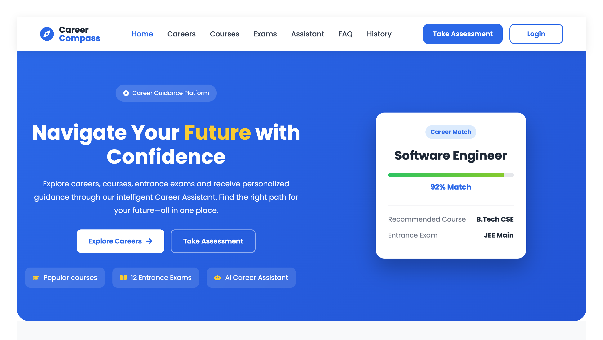
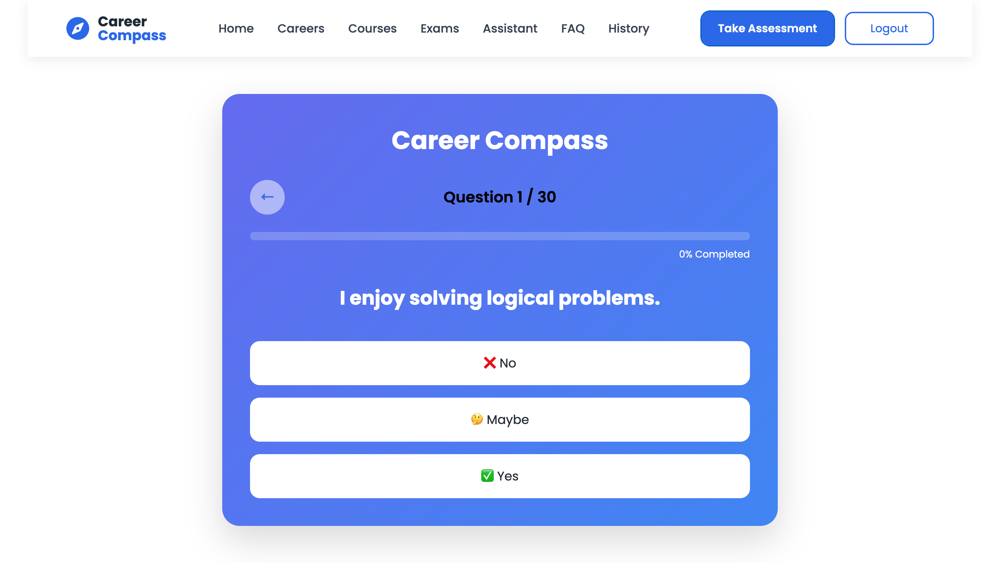
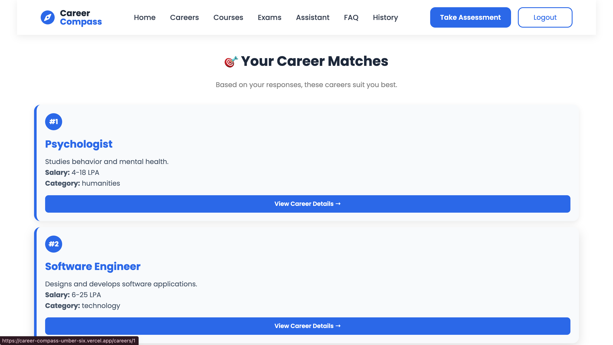
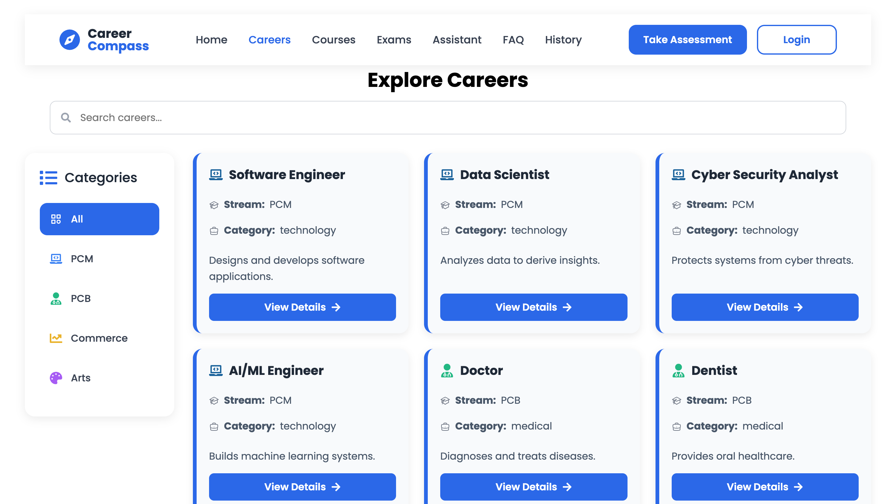
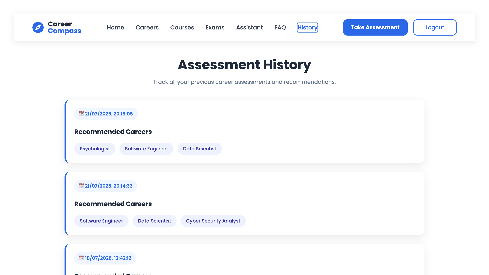
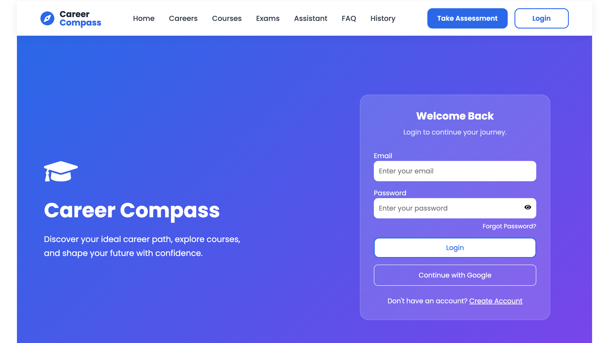

# 🎓 Career Compass

Career Compass is a full-stack career guidance platform designed to help students explore career opportunities, courses, and entrance exams and receive personalized career recommendations through an interactive assessment.

The platform provides a centralized place for students to discover different career paths and make informed decisions about their future.

---

## 🌐 Live Demo

**Frontend:**  
https://career-compass-umber-six.vercel.app

**Backend API:**  
https://career-compass-q3tj.onrender.com

> **Note:** The backend is hosted on Render's free tier, so the first request may take a little longer if the server has been inactive.

---

## ✨ Features

- 🔐 User Registration and Login
- 🔑 JWT-based Authentication
- 🎯 Interactive Career Assessment
- 📊 Personalized Career Recommendations
- 💼 Explore Different Career Paths
- 📚 Browse Courses and Course Details
- 📝 Explore Entrance Exams and Exam Details
- 🤖 AI Career Navigation Assistant
- 📈 Personalized User Dashboard
- 🕒 Assessment History
- 🔒 Protected User Routes
- 🔔 Toast Notifications
- 📱 Responsive and Modern User Interface

---

## 🛠️ Tech Stack

### Frontend

- React.js
- Vite
- React Router
- Axios
- React Icons
- React Hot Toast
- CSS

### Backend

- Node.js
- Express.js
- MongoDB
- Mongoose
- JSON Web Token (JWT)
- bcryptjs
- CORS
- dotenv

### Database

- MongoDB Atlas

### Deployment

- Vercel — Frontend
- Render — Backend
- MongoDB Atlas — Database

---

## 📸 Screenshots

### 🏠 Home Page



### 🎯 Career Assessment



### 📊 Career Recommendations



### 💼 Career Details



### 🕒 Assessment History



### 🔐 Login Page



---

## 🚀 Installation and Setup

Follow the steps below to run Career Compass locally.

### 1. Clone the Repository

```bash
git clone https://github.com/tiya-15/career-compass.git
```

### 2. Navigate to the Project Directory

```bash
cd career-compass
```

### 3. Install Frontend Dependencies

```bash
npm install
```

### 4. Install Backend Dependencies

```bash
cd backend
npm install
```

### 5. Configure Backend Environment Variables

Create a `.env` file inside the `backend` directory.

```env
PORT=5000
MONGO_URI=your_mongodb_connection_string
JWT_SECRET=your_jwt_secret
CLIENT_URL=http://localhost:5173
```

> Never commit your actual `.env` file or secret credentials to GitHub.

### 6. Start the Backend Server

From the `backend` directory:

```bash
npm run dev
```

The backend will run locally at:

```text
http://localhost:5000
```

### 7. Start the Frontend

Open another terminal and navigate to the project root:

```bash
cd career-compass
```

Then run:

```bash
npm run dev
```

The frontend will run locally at:

```text
http://localhost:5173
```

---

## 🔐 Environment Variables

### Backend Environment Variables

Create a `.env` file inside the `backend` folder.

| Variable | Description |
| --- | --- |
| `PORT` | Port used by the backend server during local development |
| `MONGO_URI` | MongoDB Atlas connection string |
| `JWT_SECRET` | Secret key used for JWT authentication |
| `CLIENT_URL` | Frontend URL allowed to communicate with the backend |

Example:

```env
PORT=5000
MONGO_URI=your_mongodb_connection_string
JWT_SECRET=your_jwt_secret
CLIENT_URL=http://localhost:5173
```

### Frontend Environment Variable

For production deployment, configure:

```env
VITE_API_URL=your_backend_url
```

For example, the deployed frontend uses the Render backend as its API server.

---

## 📁 Project Structure

```text
career-compass/
│
├── backend/
│   ├── config/
│   ├── controllers/
│   ├── middleware/
│   ├── models/
│   ├── routes/
│   ├── .env
│   ├── package.json
│   └── server.js
│
├── screenshots/
│   ├── home.png
│   ├── assessment.png
│   ├── recommendations.png
│   ├── career-details.png
│   ├── history.png
│   └── login.png
│
├── src/
│   ├── components/
│   ├── data/
│   ├── pages/
│   ├── utils/
│   ├── App.jsx
│   └── main.jsx
│
├── public/
├── index.html
├── package.json
├── vite.config.js
└── README.md
```

---

## 🔄 Application Workflow

1. A user can create an account or log in to Career Compass.
2. The user can explore careers, courses, and entrance exams.
3. The Career Assessment asks a series of questions based on the user's interests.
4. The recommendation system evaluates the responses and suggests suitable career paths.
5. Logged-in users can save their assessment results.
6. Previous assessments can be viewed from the Assessment History section.
7. The personalized dashboard displays useful information related to the user's assessments and recommendations.

---


Career Compass was developed collaboratively as a team project, with both members contributing to the design, development, integration, debugging, and deployment of the application.

---

## 🔮 Future Improvements

- Google Authentication
- Forgot Password / Password Reset
- More Careers, Courses, and Entrance Exams
- Advanced Career Recommendation Algorithm
- Improved AI Career Assistant
- User Profile Management
- Additional Dashboard Analytics
- Enhanced Search and Filtering
- More Personalized Career Insights

---

## 🚀 Deployment

The application is deployed using:

- **Frontend:** Vercel
- **Backend:** Render
- **Database:** MongoDB Atlas

The production frontend communicates with the deployed backend through REST APIs.

---

## 🤝 Feedback

Feedback and suggestions are always welcome.

If you find this project useful or interesting, consider giving the repository a ⭐.

---

## 📄 License

This project was developed for educational and portfolio purposes.
